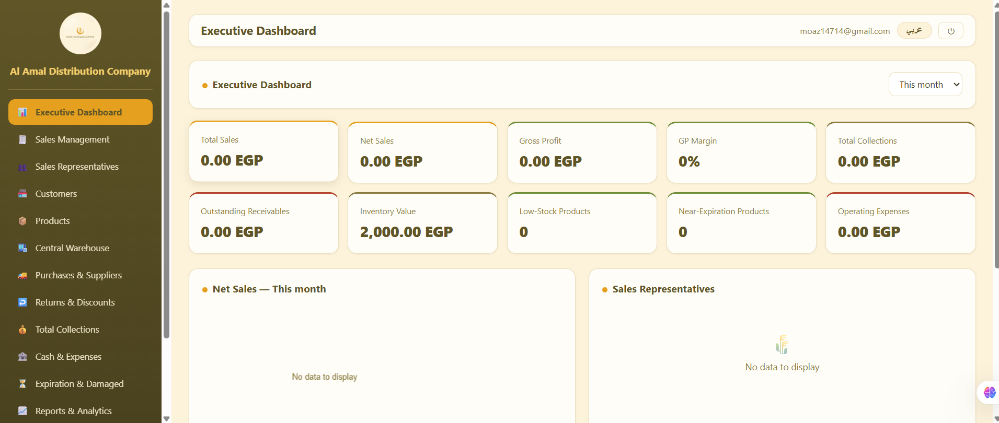
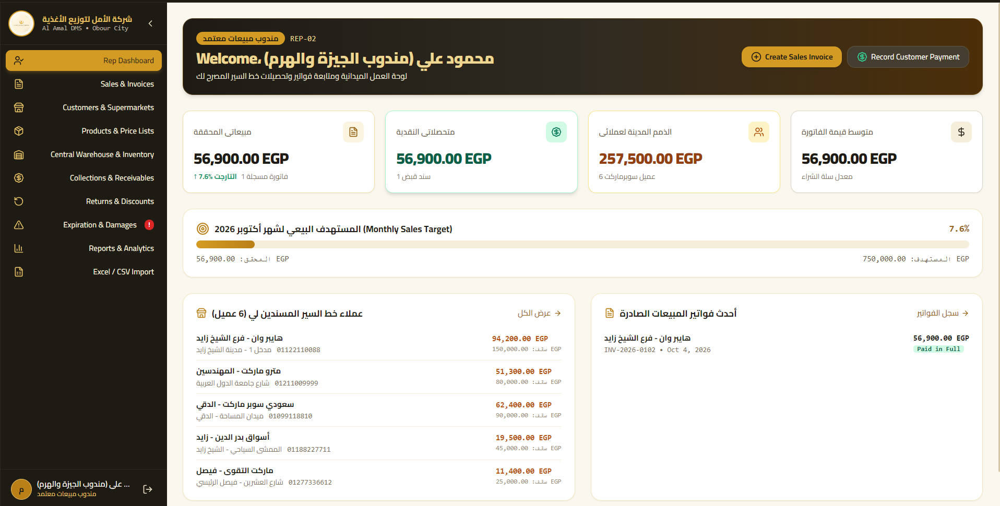
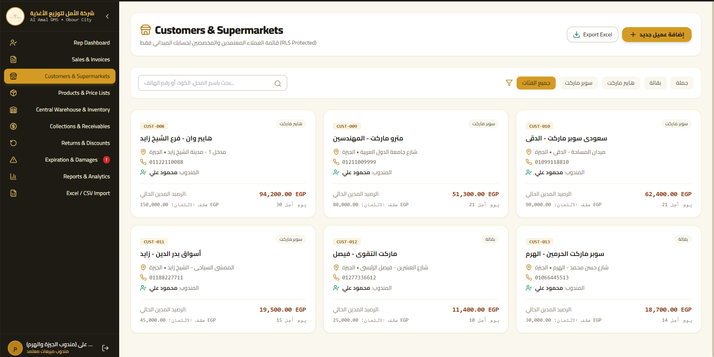
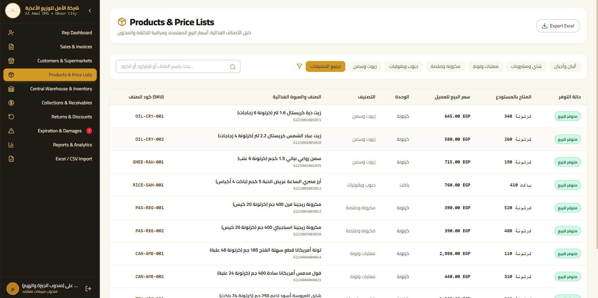
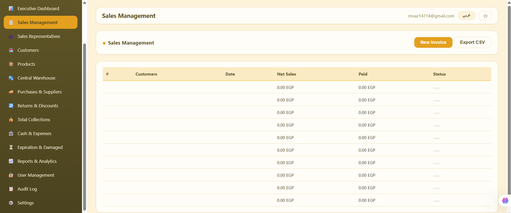
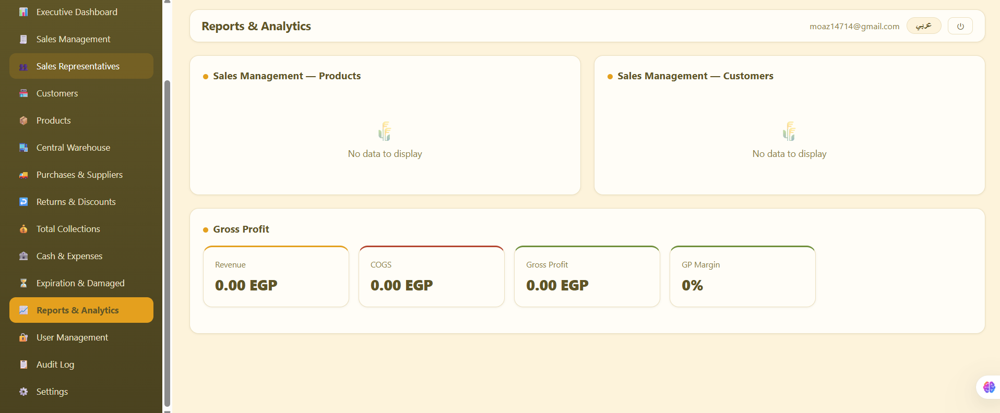

# Al Amal Distribution Management System (Desktop ERP)
### Enterprise Windows Desktop Application (Electron • React 18 • TypeScript • Supabase RLS)

[-0078D6?logo=windows&logoColor=white)](https://microsoft.com)
[](https://electronjs.org/)
[](https://reactjs.org/)
[](https://supabase.com/)
[-brightgreen)](#-automated-testing-suite)

---

## 📸 Production Screen Gallery

### 1. Executive Management Dashboard (CEO Consolidated View)
<p align="center">
  
  <em>Figure 1: Executive Dashboard tracking Net Sales, Collections, Gross Profit, Receivables, Warehouse Inventory Value, and Low-Stock/Near-Expiration batch alarms.</em>
</p>

### 2. Field Representative Route Dashboard (PostgreSQL RLS Scoped)
<p align="center">
  
  <em>Figure 2: Route-specific field sales dashboard for Rep 2 (Giza & Haram). Enforces strict boundary isolation over assigned supermarkets, route sales quota, and collection progress.</em>
</p>

### 3. Credit Governance & Route Supermarket Accounts
<p align="center">
  
  <em>Figure 3: Territory customer management enforcing credit limits (سقف الائتمان), active debit balances, and payment terms (e.g. Hyper One, Metro Market, Seoudi Supermarket).</em>
</p>

### 4. Product Catalog & Warehouse Inventory Valuation
<p align="center">
  
  <em>Figure 4: Complete FMCG product directory with SKUs, authorized wholesale prices, and real-time physical warehouse stock availability.</em>
</p>

### 5. Sales Invoicing & Dispatch Ledger
<p align="center">
  
  <em>Figure 5: High-speed invoice generation with automated inventory reservation, VAT calculation, and CSV export.</em>
</p>

### 6. Profitability Decomposition & Financial Analytics
<p align="center">
  
  <em>Figure 6: Real-time COGS, gross revenue, and gross profit margin decomposition across product lines and distribution routes.</em>
</p>

---

## 🌾 Overview & Purpose

**Al Amal Distribution Management System** is a standalone, offline-ready Windows desktop ERP engineered for food distributors in Cairo and the regional Egyptian market. 

Built with the company's signature brand identity (Wheat Amber Gold `#D49B24`, Charcoal Bronze `#1E1B15`, and Warm Cream `#FAF7EE`), it solves the core operational challenges of FMCG distribution:
1. **Executive CEO Suite:** Complete company oversight, live central inventory, gross profit margins, cash treasury vs. operational expenses, and receivables aging.
2. **Field Sales Representatives (3 Territories):** Isolated route dashboards enforcing territory boundaries via **PostgreSQL Row-Level Security (RLS)** for sales invoicing, order creation, and collections.

---

## 🛡️ Role-Based Architecture & Route Scoping

| Account / Role | Email | Geographic Route / Scope | Authorized Capabilities |
|:---|:---|:---|:---|
| **CEO / General Manager** | `manager@alamal-eg.com` | Consolidated (All Routes) | Full executive suite: inventory, purchases, expenses, reps performance, audit logs. |
| **Sales Rep 1 (North Cairo)** | `rep1@alamal-eg.com` | Shubra, Zaytoun, Heliopolis | Territory-isolated invoices, customers, and payment receipts. |
| **Sales Rep 2 (Giza & Haram)** | `rep2@alamal-eg.com` | Sheikh Zayed, 6th October, Mohandessin | Territory-isolated invoices, customers, and payment receipts. |
| **Sales Rep 3 (East Cairo)** | `rep3@alamal-eg.com` | New Cairo, Maadi, Nasr City | Territory-isolated invoices, customers, and payment receipts. |

---

## ⚙️ Core System Modules

- **Executive CEO Dashboard:** Multi-dimensional KPI cards (Net Sales, Collected Cash, OPEX, Receivables), monthly target attainment, and trend charts.
- **Central Warehouse & Batch Expiration:** Real-time stock counts, shelf-life monitoring, and automatic dispatch alerts for batches with $< 30$ days remaining.
- **Sales Invoicing & Dispatch:** Atomically decrements warehouse stock, validates customer credit limits, and checks rep discount limits.
- **Collections & Receivables Aging:** Tracks cash receipts, reconciles customer ledger balances, and categorizes overdue receivables.
- **Cash Treasury & OPEX:** Real-time logging of operating expenses and daily cash balance reconciliation.
- **Excel / CSV Migration:** Native file dialogs for importing legacy catalog and financial records and exporting structured audit statements.

---

## 🧪 Automated Testing Suite

The repository includes automated test suites verifying business integrity:
```bash
# Execute automated test suite
npm test
```
Tests cover:
- `auth.test.ts`: RLS isolation ensuring representatives cannot access out-of-territory records.
- `inventory.test.ts`: Prevents negative stock dispatches and verifies atomic reservation.
- `financial.test.ts`: Mathematical validation of subtotal, VAT (14%), discounts, and cash balances.

---

## 💻 Technical Stack

- **Desktop Framework:** Electron with native NSIS Windows packaging
- **Frontend UI:** React 18, TypeScript, Tailwind CSS, Lucide Icons
- **Data Visualization:** Recharts (responsive SVG charts)
- **Database & Security:** Supabase PostgreSQL with strict Row-Level Security (RLS) policies
- **Testing:** Vitest / Jest test runner

---

## 🚀 Local Development Setup

```bash
# Clone the repository
git clone https://github.com/Moazawad2002/al-amal-desktop.git
cd al-amal-desktop

# Install dependencies
npm install

# Start development server with Electron hot reload
npm run dev

# Package for Windows (NSIS Installer)
npm run package:win
```

---

## 🏷️ Repository Topics
`electron`, `react`, `typescript`, `desktop-app`, `erp`, `distribution-management`, `supabase`, `row-level-security`, `food-distribution`, `sales-management`
