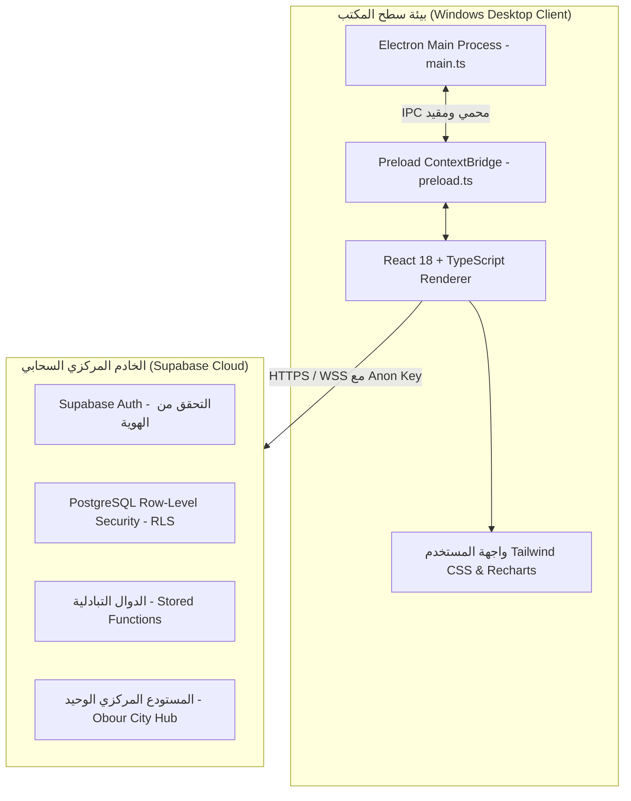

# الهيكل الفني ومعايير الأمان لتطبيق سطح المكتب
## شركة الأمل لتوزيع المنتجات الغذائية (Al Amal Distribution Management System)

### 1. معمارية التطبيق (Architecture Overview)

---

### 2. معايير أمان إلكترون (Electron Hardened Security)

تم تصميم عملية إلكترون وفق أعلى معايير أمان OWASP لتطبيقات سطح المكتب:

- **عزل السياق (Context Isolation):** تم تفعيل `contextIsolation: true` بالكامل لمنع كود الواجهة من النفاذ لأي من خصائص Node.js الحساسة.
- **إلغاء Node Integration:** تم ضبط `nodeIntegration: false`، مما يمنع تشغيل أي أوامر نظام غير مصرح بها.
- **تأمين ContextBridge:** تم تصدير دوال محددة بدقة شديدة:
  - التحكم في النوافذ (Minimize, Maximize, Close).
  - منتقي الملفات الأصلي من الويندوز (Open/Save File Dialogs).
  - واجهة الطباعة المكتبية (Print to Paper/PDF).
- **سياسة أمان المحتوى (CSP):** تم تقييد مصادر المحتوى بدقة لمنع أي هجمات XSS أو تنزيل كود غير موثوق.
- **منع النوافذ الخارجية والروابط العشوائية:** يتم حظر أي استدعاء لـ `window.open` من خلال `setWindowOpenHandler: () => ({ action: 'deny' })`.

---

### 3. سياسات أمان قاعدة البيانات (PostgreSQL RLS)

تعتمد الحماية على مستوى قاعدة البيانات PostgreSQL وليس على واجهة المستخدم وحدها:

- **عزل مناديب المبيعات:**
  - كل مندوب مرتبط بـ `representative_id` فريد ومسجل في جدول `profiles`.
  - سياسات RLS على جداول `customers` و `sales_invoices` و `customer_payments` تمنع المندوب رقم 1 من قراءة أو تعديل أو استعلام أي سجل يخص المندوب رقم 2 أو 3.
- **حماية المشتريات والموردين وتكلفة البضاعة:**
  - جداول `suppliers`, `purchase_invoices`, `financial_accounts`, `expenses` محمية بسياسات تشترط `get_auth_role() = 'manager'`.
  - مناديب المبيعات لا يمكنهم معرفة أسعار تكلفة الشراء أو هوامش الربح الإجمالية للشركة.
- **منع الحذف والتعديل الصامت:**
  - الفواتير وسندات القبض المرحلة رسمياً لا يمكن تعديلها أو حذفها إلا عبر إجراءات مرتجعات أو قيود تسوية معتمدة مع تسجيل كامل في `audit_logs`.
